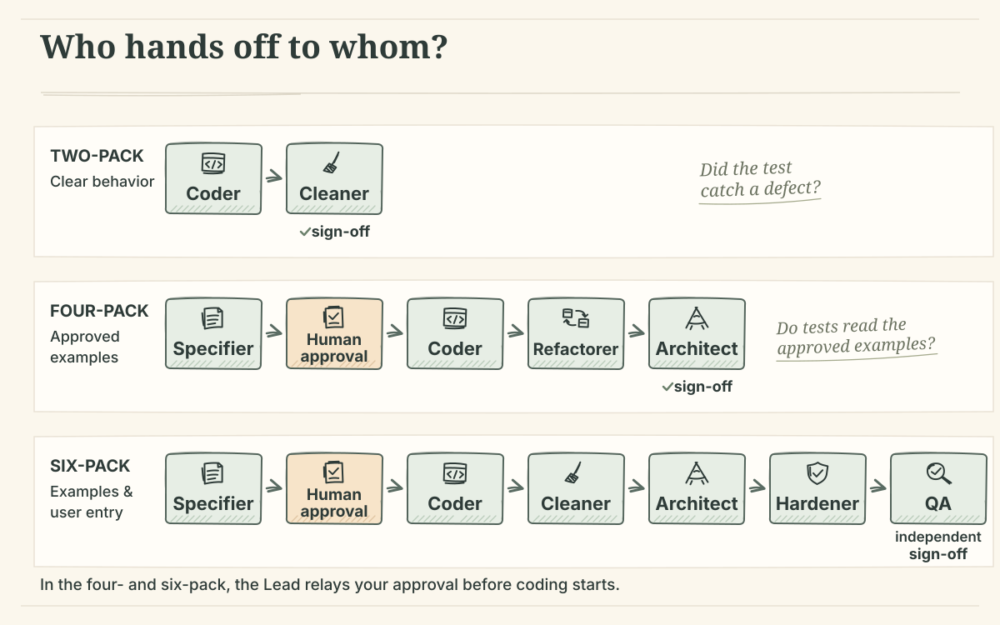
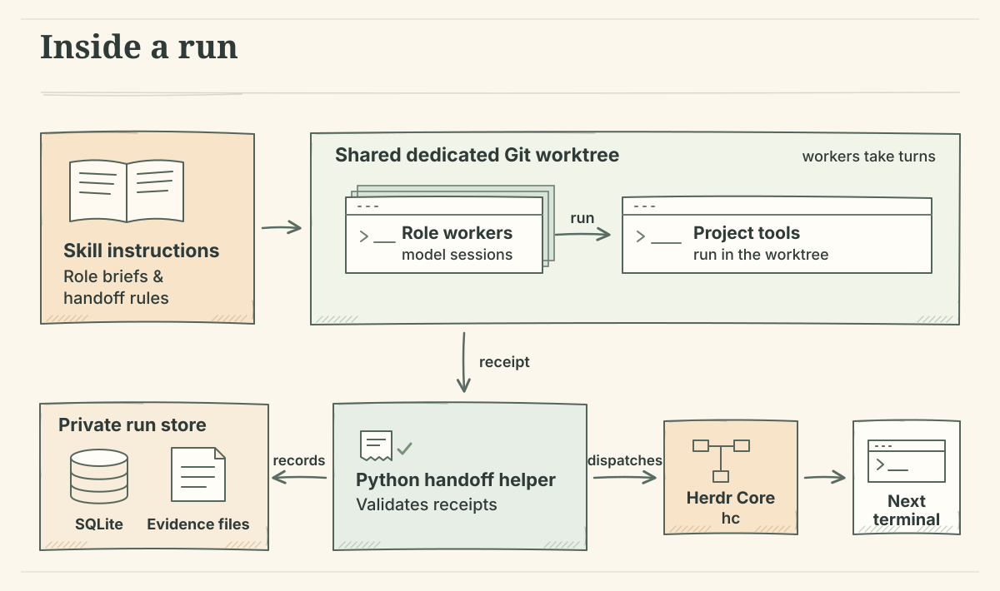

# Herdr Dev Team

English · [简体中文](README.zh-CN.md)

[Choose a pack](#choose-a-pack) · [Install with your agent](#give-this-to-your-agent) · [Configure workers](#choose-the-models-and-tools)

A coding agent fixes a CSV exporter and its tests pass. Who checked that a user can export a field containing a comma and import the file again? Herdr Dev Team is an Agent Skill for handing a change from the agent that wrote it to a teammate who can answer questions like that. You choose how much review the task needs. You get a Git commit, the name of the role that signed off, and the checks you can replay.

**Open for trials.** We have run all three packs in Herdr App. Try v0.5.1 on a small change in your own project. We'd like to hear which handoffs helped, where a role got stuck, and what evidence you needed to trust the result. Suggestions and bug reports are welcome. [Release](https://github.com/M1racleShih/herdr-dev-team/releases/tag/v0.5.1) · [Open an issue](https://github.com/M1racleShih/herdr-dev-team/issues)

## Choose a pack

A *pack* counts the workers. You give the **Delivery Lead** a goal and observable acceptance criteria. The Lead prepares a dedicated Git branch and worktree, starts one interactive terminal per role and brings decisions back to you. The workers take turns in that worktree. You decide whether to merge or push the accepted commit.



### Two-pack · The expected behavior is clear

For a known CSV quoting bug, give the team the failing input and expected output. **Coder** writes a failing test and fixes the exporter. **Cleaner** checks the commit independently, improves the code or tests where needed, then introduces a small defect in a disposable copy to show that the test catches it. Cleaner signs off or sends the reproducible failure back to Coder. [Two-pack guide](skills/herdr-dev-team/references/two-pack.md)

### Four-pack · You want to agree on examples before coding

Suppose callers disagree on what an empty CSV row means. **Specifier** writes executable behavior examples, and the Lead shows you the exact committed version for approval. **Coder** implements that agreement and writes a test that reads the approved examples. **Refactorer** simplifies the implementation and checks a property such as an export/import round trip. **Architect** traces the module boundaries and checks that changing either the code or an expected value makes the right test fail. Architect signs off on that commit. [Four-pack guide](skills/herdr-dev-team/references/four-pack.md)

### Six-pack · The user's actual workflow needs a witness

If a release depends on the export and import commands working together, **Specifier** submits both examples and the user commands with expected output and exit status for your approval. **Coder** implements the behavior. **Cleaner** tightens the changed code and tests. **Architect** checks how the behavior crosses module boundaries. **Hardener** looks for regressions the tests would miss, using a targeted defect or the project's chosen hardening check. **Independent QA** runs the approved commands through the real entry point and signs off on what actually happened. QA can fix a localized defect and replay the same script, return broader failures to Coder, or bring conflicting requirements back to you. [Six-pack guide](skills/herdr-dev-team/references/six-pack.md)

## Install v0.5.1

For a live run you need a POSIX host with Git, Python 3.8+, a shared local filesystem, and Herdr Core (`hc`). Run the Lead in an interactive Herdr terminal that can receive messages. The documented worker setup uses Pi with a configured model provider. Install Herdr App if you want to watch the workers in separate panes. [Herdr Core](https://github.com/herdrdev/herdr-core) · [Pi](https://pi.dev) · [Herdr App](https://github.com/herdrdev/herdr-app)

### Give this to your agent

Paste this into your agent from the project where you want to use the skill.

```text
Install Herdr Dev Team v0.5.1 for this project from
https://github.com/M1racleShih/herdr-dev-team.git at tag v0.5.1.
In skills/herdr-dev-team, read SKILL.md and references/handoffs.md.
Install the complete skills/herdr-dev-team directory using this project's
existing skill manager or the Lead agent's skill discovery directory.
If upgrading, check for active runs and follow the README upgrade notes.
Refresh skill discovery and confirm that the Lead can find herdr-dev-team.
Run python3 -B <installed-skill>/scripts/handoff.py --help and verify it
lists two, four and six. Check Git, Python, hc and Pi for a live run.
Report the installed path, version and any missing prerequisites.
Stop after setup so I can choose the first task and pack.
```

### Install by hand

Copy or link the **whole skill directory**, including `references/` and `scripts/`. Here is a fresh install from the root of a project whose Lead discovers `.agents/skills`. Change `skills_dir` to match your agent. Keep the source checkout for as long as you use the link.

```sh
source_dir="$HOME/.local/share/herdr-dev-team-v0.5.1"
skills_dir=".agents/skills"
mkdir -p "$HOME/.local/share" "$skills_dir"
git clone --depth 1 --branch v0.5.1 https://github.com/M1racleShih/herdr-dev-team.git "$source_dir"
ln -s "$source_dir/skills/herdr-dev-team" "$skills_dir/"
python3 -B "$skills_dir/herdr-dev-team/scripts/handoff.py" --help
```

The help output lists `STORE {two,four,six}`. Refresh or restart the Lead and confirm that `herdr-dev-team` appears in its skill list.

<details>
<summary>Install or upgrade with dskills</summary>

We use `dskills` to manage skills across our projects. If you also use it, import the release into your pool, then activate it for the target project.

```sh
dskills install https://github.com/M1racleShih/herdr-dev-team.git --ref v0.5.1 --skill skills/herdr-dev-team
# Run init only for a new dskills project. This example uses a Codex Lead.
dskills init --project . --agent codex
dskills plug --project . herdr-dev-team
dskills status --project .
```

When an earlier tag is already in the pool, import the new one under a separate ID. Check which ID is active in this project, unplug that ID if present, then plug the new one. Refresh the Lead afterward.

```sh
dskills install https://github.com/M1racleShih/herdr-dev-team.git --ref v0.5.1 --skill skills/herdr-dev-team --id herdr-dev-team-v0-5-1
dskills status --project .
# Set OLD_ID to the active ID shown above. Skip unplug if none is active.
dskills unplug --project . "$OLD_ID"
dskills plug --project . herdr-dev-team-v0-5-1
dskills status --project .
```

</details>

**Upgrading an active project?** Finish legacy Coder/Reviewer runs with the v0.4.0 helper and archive their `state.json` before switching. Existing SQLite pack runs can continue with the v0.5.1 helper. Each run keeps the role instructions it received at initialization. Start a new six-pack to use the updated Coder instructions.

## Run your first task

Give the Lead a goal, a pack and a way to tell when the work is done.

> Use Herdr Dev Team six-pack to fix our CSV export. A field containing a comma must survive an export/import round trip. Have QA run our public export and import commands. Show me the examples and commands before coding starts.

For four- and six-pack, read the Specifier's examples when the Lead brings them back. Approve that version or ask for a change. Once approved, ordinary handoffs proceed between the workers, including while the Lead is offline. At the end, ask the Lead for the accepted commit and the evidence for your example.

## Choose the models and tools

**Model and thinking level.** Set these per worker at launch. Run `pi --list-models` to see available provider/model pairs. Set `PROVIDER` and `WORKER_MODEL` to your selection, `WORKER_NAME` to a unique name, and `WORKTREE` to the absolute path of the pack's worktree. This example gives one worker `medium` thinking. Choose a level the model supports and repeat for each role.

```sh
WORKER_THINKING=medium
hc run --bg --json --no-parent --name "$WORKER_NAME" --cwd "$WORKTREE" \
  pi --provider "$PROVIDER" --model "$WORKER_MODEL" --thinking "$WORKER_THINKING"
```

Record each returned `address` and confirm Pi is ready before giving the IDs to the helper. To select the worker's built-in tools, append, for example, `--tools read,bash,edit,write,grep` to the Pi arguments. The six-pack Coder follows your project's coding conventions by default. If you or your project explicitly choose an extra skill such as Ponytail, use the copy Pi discovers or append `--skill /absolute/path/to/SKILL.md` to that worker's launch command. [Worker launch guide](skills/herdr-dev-team/references/handoffs.md#launch-the-workers) · [Ponytail](https://github.com/DietrichGebert/ponytail)

**Project checks.** With `--checks FILE`, list each role's named commands and expected exit codes in JSON. Start from the file format in your pack guide. The built-in mutation check expects verbose Python unittest output. Six-pack also accepts `--plan FILE` for project-specific tools. For example, the bundled Rust reader assigns `./ci/check compat fixtures/v1/manifest.json` to Hardener to verify that the reader still opens old files. A plan states who runs each check, what it must demonstrate and when it matters. A `stage` check gates its owner's handoff, a `final` check needs passing evidence on the final commit, and `observe` records a finding for review. [Copyable quality plan and adapter format](skills/herdr-dev-team/references/six-pack.md#use-a-project-quality-plan)

## How a handoff works



| Part | What it does |
| --- | --- |
| Skill | Gives the Lead and workers their role briefs, scope, required checks, handoff rules and reasons to pause for a person. |
| Models | Read the assigned commit, make engineering decisions, edit the worktree and explain the evidence. Project tools produce the test results. |
| Python helper and Herdr Core | The helper checks the reporting terminal, assignment, Git commit and required evidence, records the handoff in SQLite and sends the next assignment via `hc`. The private store outside the worktree keeps the logs and evidence files. |

These records matter when work fails or a session drops. Missing evidence leaves the assignment open. An identical accepted report reuses the recorded decision. For four- and six-pack, approval binds the specification version and SHA-256. Changing the committed examples requires fresh approval. To inspect an interrupted run, use `resume`. Use `recover` to dispatch an assignment the helper has never tried to send. If delivery is uncertain, inspect the original terminal before reconciling the attempt. [Recovery guide](skills/herdr-dev-team/references/four-pack.md#recover-revise-or-repair)

**Try the handoff locally.** From this repository with Python, Git and `rustc`, run `python3 -B tests/try_quality_reader.py`. The fixture uses simulated approvals and message delivery, compiles a real Rust reader and prints the accepted commit and a command to inspect its evidence. To run the same regression suite as CI, use `python3 -B -m unittest discover -s tests -v`.

## Acknowledgments

The idea for these packs and their division of roles comes from **swarm-forge**. We adapted that workflow to local Herdr terminals, with a durable record of each handoff. [Original swarm-forge project](https://github.com/unclebob/swarm-forge)
