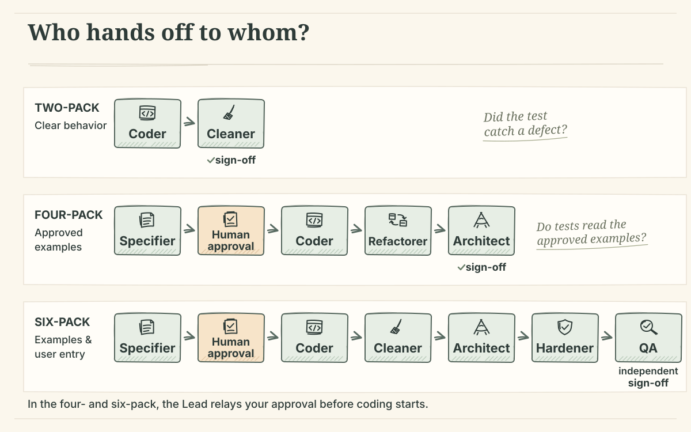
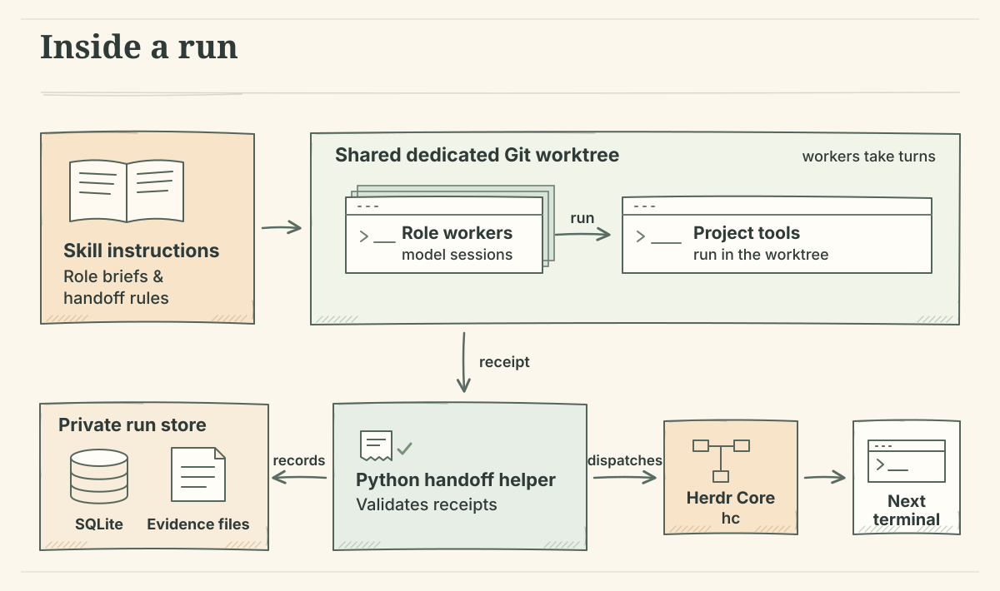

# Herdr Dev Team

[English](README.md) · 简体中文

[怎么选 pack](#怎么选-pack) · [复制给 agent 安装](#复制给-agent-安装) · [配置模型和工具](#配置模型思考强度和工具)

一个编码 agent 修好了 CSV 导出，测试也全绿了。可用户把含逗号的字段导出、再导入，还能读回原值吗？谁实际跑过？Herdr Dev Team 是一个 Agent Skill，让写代码的 agent 把改动交给另一个有明确职责的队友来验证。你可以按任务选择需要几道检查。交付时，你能拿到具体的 Git 提交，知道由哪个角色签收，还能亲自重跑它用来签收的检查。

**目前处于试用阶段。** 三种 pack 都已在 Herdr App 中实际跑通。欢迎用 v0.5.1 在自己的项目里试一个小改动，告诉我们哪次交接有帮助、哪个角色容易卡住、你还需要哪些证据才能放心合并。建议和问题都欢迎提到 GitHub Issues。[查看版本](https://github.com/M1racleShih/herdr-dev-team/releases/tag/v0.5.1) · [反馈问题或建议](https://github.com/M1racleShih/herdr-dev-team/issues)

## 怎么选 pack

Pack 的人数只计算执行任务的角色。你把目标和可观察的验收条件交给 **Delivery Lead（协调者）**。Lead 准备专用的 Git 分支和工作树，为每个角色启动独立的交互终端，并把需要你决定的问题带回来。各角色轮流在同一工作树里工作。签收后，由你决定是否合并或推送。



### Two-pack · 预期行为已经明确

如果 CSV 引号处理有个能复现的错误，把出错的输入和正确输出交给两人组。**Coder（开发）** 先写出能复现错误的测试，再修导出逻辑。**Cleaner（清理与复核）** 独立检查提交，必要时改进代码和测试，还会在一次性副本里故意改坏一处实现，确认测试确实能抓住它。通过后由 Cleaner 签收，发现行为仍有误就带着复现证据退回 Coder。[Two-pack 操作手册](skills/herdr-dev-team/references/two-pack.md)

### Four-pack · 需要先把预期说清楚

假设调用方对 CSV 中的空行该怎么处理有分歧。**Specifier（规格编写）** 把预期写成可用于验收的示例，Lead 把提交的原文交给你确认。你批准后，**Coder（开发）** 实现约定，并让验收测试直接读取获批示例。**Refactorer（重构）** 简化实现，验证诸如“导出后再导入能还原原值”的性质。**Architect（架构复核）** 检查模块边界，还会分别改坏实现、改错示例的期望值，确认对应测试两次都能报错，最后签收该提交。[Four-pack 操作手册](skills/herdr-dev-team/references/four-pack.md)

### Six-pack · 需要有人走完用户实际操作的步骤

如果发布前必须确认导出和导入命令能配合工作，**Specifier（规格编写）** 会把行为示例、用户要运行的命令、预期输出和退出码一并交给你批准。**Coder（开发）** 实现约定。**Cleaner（清理与复核）** 改进本次变动的代码和测试。**Architect（架构复核）** 沿调用路径检查模块边界。**Hardener（测试加固）** 寻找现有测试可能漏掉的回归，可以故意引入一个缺陷，也可以使用项目指定的加固检查。**独立 QA（用户入口验收）** 从真实入口执行获批命令，核对实际结果后签收。遇到局部缺陷，QA 可以修复并重跑原脚本。涉及更广的实现问题就退回 Coder，遇到需求冲突则请你裁定。[Six-pack 操作手册](skills/herdr-dev-team/references/six-pack.md)

## 安装 v0.5.1

实际运行需要 POSIX 系统、Git、Python 3.8 或更高版本、各终端可访问的本地文件系统，以及 Herdr Core 提供的 `hc`。Lead 要运行在能接收消息的 Herdr 交互终端里。本文的 worker 使用 Pi，需要先在 Pi 里配置可用的模型服务。想在分栏里观察各角色时，可以使用 Herdr App。[Herdr Core](https://github.com/herdrdev/herdr-core) · [Pi](https://pi.dev) · [Herdr App](https://github.com/herdrdev/herdr-app)

### 复制给 agent 安装

在要使用这个 skill 的项目里，把以下文字发给 agent。

```text
请为当前项目安装 Herdr Dev Team v0.5.1。仓库是
https://github.com/M1racleShih/herdr-dev-team.git，使用标签 v0.5.1。
先读 skills/herdr-dev-team/SKILL.md，以及该 skill 目录下的 references/handoffs.md。
沿用项目已有的 skill 管理器，或将完整的 skills/herdr-dev-team 目录放入 Lead
能发现 skill 的位置。如需升级，先检查是否有进行中的运行，并按 README 的升级说明处理。
刷新 skill 列表，确认 Lead 能发现 herdr-dev-team。执行
python3 -B <已安装的 skill 目录>/scripts/handoff.py --help，核对有 two、four、six
三个入口。检查实跑需要的 Git、Python、hc 和 Pi，告诉我安装位置、版本和缺少的依赖。
完成安装就停下，由我来选第一次试用的任务和 pack。
```

### 手动安装

将**整个 skill 目录**复制或链接到 agent 的 skill 发现目录，保留 `references/` 和 `scripts/`。下面是从目标项目根目录全新安装的例子，假设 Lead 会查找 `.agents/skills`。按你的 agent 调整 `skills_dir`。使用符号链接时，请保留它指向的源码目录。

```sh
source_dir="$HOME/.local/share/herdr-dev-team-v0.5.1"
skills_dir=".agents/skills"
mkdir -p "$HOME/.local/share" "$skills_dir"
git clone --depth 1 --branch v0.5.1 https://github.com/M1racleShih/herdr-dev-team.git "$source_dir"
ln -s "$source_dir/skills/herdr-dev-team" "$skills_dir/"
python3 -B "$skills_dir/herdr-dev-team/scripts/handoff.py" --help
```

帮助中应列出 `STORE {two,four,six}`。刷新或重启 Lead，确认它的 skill 列表里出现了 `herdr-dev-team`。

<details>
<summary>使用 dskills 安装或升级</summary>

我们用 `dskills` 在多个项目间管理 skill。如果你也使用它，先将发行版导入本地池，再为目标项目启用。

```sh
dskills install https://github.com/M1racleShih/herdr-dev-team.git --ref v0.5.1 --skill skills/herdr-dev-team
# 仅在尚未使用 dskills 的项目执行 init。这里以 Codex 担任 Lead 为例。
dskills init --project . --agent codex
dskills plug --project . herdr-dev-team
dskills status --project .
```

如果池里已有旧版，用另一个 ID 导入新版。查明当前项目正在使用哪个 ID，停用该 ID（如有），再启用新版，然后刷新 Lead。

```sh
dskills install https://github.com/M1racleShih/herdr-dev-team.git --ref v0.5.1 --skill skills/herdr-dev-team --id herdr-dev-team-v0-5-1
dskills status --project .
# 把 OLD_ID 设为当前启用的 ID。如果没有启用旧版，跳过 unplug。
dskills unplug --project . "$OLD_ID"
dskills plug --project . herdr-dev-team-v0-5-1
dskills status --project .
```

</details>

**有任务正在运行时怎么升级？** 旧版 Coder/Reviewer 流程请先用 v0.4.0 的 helper 跑完，归档其 `state.json` 后再切换。已经用 SQLite 保存的 pack 运行可以直接用 v0.5.1 的 helper 继续。每个运行会保留初始化时的角色说明。要让 Coder 收到新版指令，请新建一次 six-pack 运行。

## 交给团队的第一个任务

告诉 Lead 你的目标、选用的 pack，以及判断任务是否完成的方法。

> 用 Herdr Dev Team 的 six-pack 修复 CSV 导出。含逗号的字段导出再导入后，必须能读回原值。请 QA 实际运行我们的导出和导入命令。开始编码前，把示例和命令给我确认。

使用 four-pack 或 six-pack 时，等 Lead 送来 Specifier 的示例，批准该版本或提出修改。批准后，角色之间会自行交接，Lead 短暂离线也能继续。最后可以请 Lead 给出签收的提交，以及你的示例在该提交上的验证结果。

## 配置模型、思考强度和工具

**每个角色的模型与思考强度。** 启动 worker 前，用 `pi --list-models` 查看可用的服务商和模型。将 `PROVIDER`、`WORKER_MODEL` 设为选中的值，给 `WORKER_NAME` 一个唯一名称，`WORKTREE` 填本轮工作树的绝对路径。下面给一个 worker 设置 `medium` 思考强度。按各角色的任务和模型支持的等级分别启动即可。

```sh
WORKER_THINKING=medium
hc run --bg --json --no-parent --name "$WORKER_NAME" --cwd "$WORKTREE" \
  pi --provider "$PROVIDER" --model "$WORKER_MODEL" --thinking "$WORKER_THINKING"
```

保存每次返回的 `address`，确认 Pi 就绪后再把终端 ID 交给 helper。要选择 worker 可用的内置工具，可以在 Pi 参数后追加 `--tools read,bash,edit,write,grep`。Six-pack 的 Coder 默认遵循项目的编码约定。只有你或项目明确选用 Ponytail 等额外 skill 时，才让该角色使用 Pi 已发现的副本，或在启动参数中追加 `--skill /absolute/path/to/SKILL.md`。[Worker 启动指南](skills/herdr-dev-team/references/handoffs.md#launch-the-workers) · [Ponytail](https://github.com/DietrichGebert/ponytail)

**项目自己的检查工具。** 用 `--checks FILE` 传入 JSON，按角色列出检查名称、命令和预期退出码。各 pack 手册都有对应模板。内置的变异检查会读取 Python unittest 的详细输出。Six-pack 还支持用 `--plan FILE` 接入项目自己的工具。例如，仓库里的 Rust 读取器把 `./ci/check compat fixtures/v1/manifest.json` 交给 Hardener，检查改动后能否读回旧格式文件。计划里写明谁来跑、验证什么、结果用于哪一步。`stage` 必须通过才能交给下一角色，`final` 需要有最终提交上的通过证据，`observe` 记录一次观察供复核。[可复制的质量计划与适配器格式](skills/herdr-dev-team/references/six-pack.md#use-a-project-quality-plan)

## 一次交接是怎样完成的



| 组成部分 | 承担的工作 |
| --- | --- |
| Skill | 给 Lead 和各角色提供操作说明，明确工作范围、要做的检查、交给谁，以及何时需要找用户决策。 |
| 模型 | 读取分配到的提交，做工程判断、修改工作树、解释证据。测试结果来自实际运行的项目工具。 |
| Python helper 和 Herdr Core | Helper 核对报告来自哪个终端、对应哪次派工和哪份提交、必需证据是否齐全。它将交接写入 SQLite，再通过 `hc` 把任务送到下一角色的终端。日志和证据文件保存在工作树外的私有目录。 |

这些记录让中断后的接手有据可查。证据缺失时，任务留在当前角色。重复提交相同的已接收回执，会得到上次的决定。Four-pack 和 six-pack 的批准绑定规格版本与 SHA-256，只要提交的示例发生变化，就要重新批准。运行中断时用 `resume` 查看记录，用 `recover` 发送尚未尝试投递的任务。如果投递结果不明，先核对原终端，再登记该次投递的实际情况。[恢复操作手册](skills/herdr-dev-team/references/four-pack.md#recover-revise-or-repair)

**在本机观察一次交接。** 准备好 Python、Git 和 `rustc` 后，从本仓库根目录执行 `python3 -B tests/try_quality_reader.py`。这个例子模拟批准和消息投递，实际编译并运行 Rust 读取器，最后输出签收提交和查看证据的命令。要运行与 CI 相同的回归套件，执行 `python3 -B -m unittest discover -s tests -v`。

## 致谢

这些 pack 的构想和角色分工来自 **swarm-forge**。我们将这套协作方式带到本地 Herdr 终端，并为每次交接保存可追溯的记录。[swarm-forge 原项目](https://github.com/unclebob/swarm-forge)
